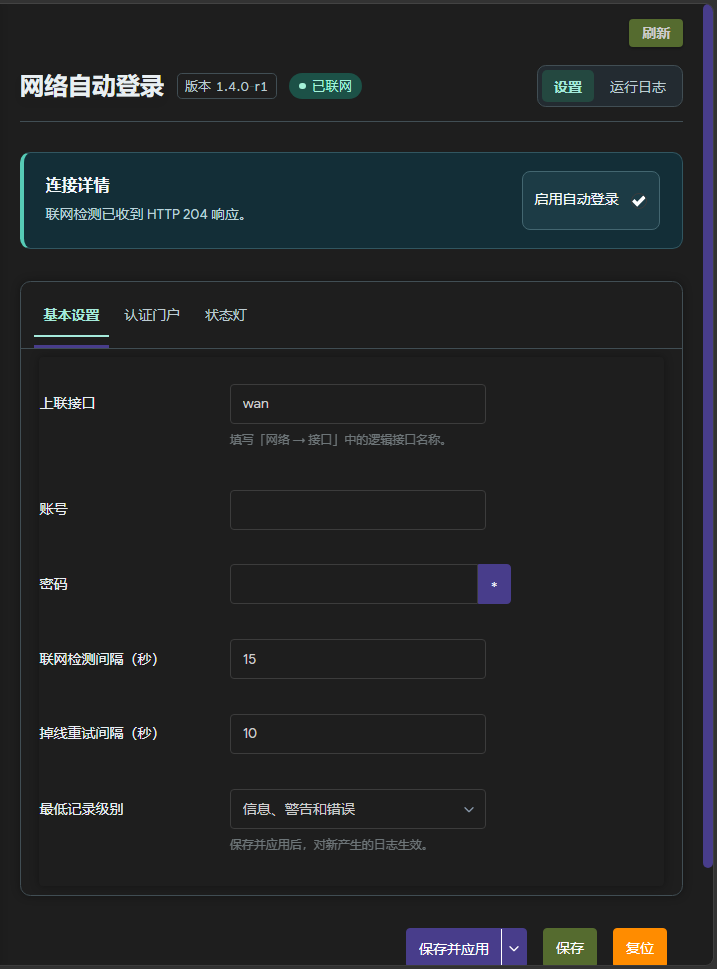
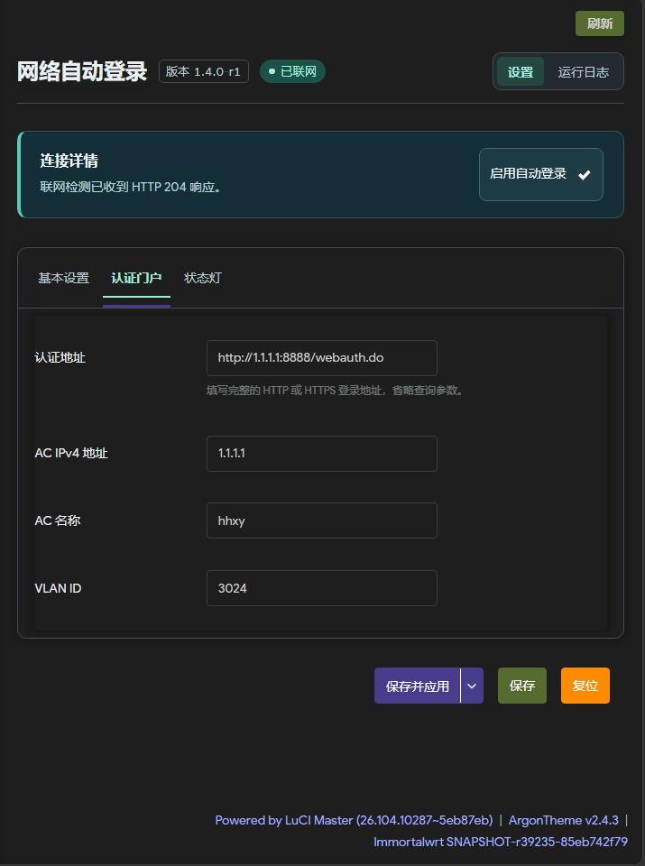
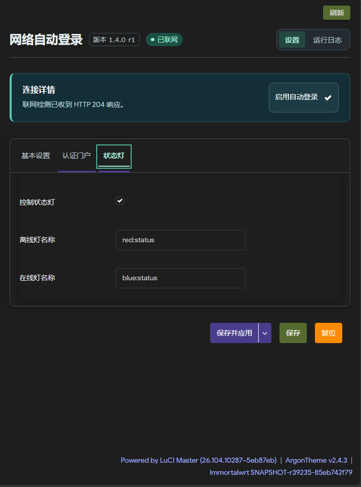

# 1.OpenWrt 网络自动登录

- 只针对移动校园网，本项目不提供校园网破解，只针对登陆逻辑。[](https://opensource.org/licenses/MIT)


插件通过 LuCI 配置认证账号。它在指定的上联接口上检测 IPv4 联网状态，掉线时向原脚本使用的 `webauth.do` 门户提交登录请求。收到 HTTP 204 后，界面显示“已联网”。
# 2.图片预览

---

---


# 3.如何安装？

用 `command -v apk` 或 `command -v opkg` 确认路由器的软件包管理器。安装包中的脚本和界面资源适用于不同 CPU 架构。安装依赖为 `luci-base`、`curl` 和 `ca-bundle`，缺少依赖时软件包管理器需要访问对应固件的软件源。

将对应的安装包上传到路由器的 `/tmp`，再通过 SSH 执行。

**OpenWrt 24.10（opkg）**

```sh
opkg update
opkg install /tmp/luci-app-net-autologin_1.4.0-r1_all.ipk
```

**OpenWrt 25.12（apk）**

```sh
apk update
apk add --allow-untrusted /tmp/luci-app-net-autologin-1.4.0-r1.apk
```

APK 是本地构建的未签名安装包，`--allow-untrusted` 仅用于这条安装命令。路由器如果需要先认证才能联网，可以保留原来的登录方式，待插件安装完成后再切换。

已安装旧版时，可直接用新版安装包升级，原有的 UCI 配置会保留。

# 4.配置

- 1. 登录 LuCI，打开 **服务 → 网络自动登录 → 设置**。安装后若刚好有已登录的 LuCI 会话，重新登录一次以加载菜单权限。
- 2. 确认上联接口名称。默认是 `wan`，也可以填「网络 → 接口」里的逻辑接口名称。
- 3. 在基本设置中输入账号和密码，打开页面顶部的“启用自动登录”开关，点击 **保存并应用**。
- 4. 标题旁显示当前插件版本和连接状态。提交认证请求后，状态会在联网检测通过时更新为“已联网”。用顶部导航切换设置和运行日志。
---
升级后若浏览器仍显示旧布局，可以重新打开页面并按 `Ctrl+F5` 强制刷新。也可通过 SSH 用 `apk list --installed luci-app-net-autologin` 或 `opkg list-installed luci-app-net-autologin` 确认已安装的版本。

认证地址、AC 参数、VLAN 和检测间隔沿用原脚本的默认值。原脚本使用 HTTP 门户，账号和密码会随 HTTP 表单发送。如果门户提供 HTTPS，可以在“认证门户”页填写对应的 HTTPS 地址。

“状态灯”设置默认关闭。启用后可填写 `ls /sys/class/leds` 列出的设备名称。插件在线时点亮在线灯，等待联网时点亮离线灯。

原脚本的账号和密码没有复制到软件包里。如果此前已安装 `/etc/init.d/net`，可以在切换到插件时停止并禁用旧服务。

```sh
/etc/init.d/net stop
/etc/init.d/net disable
```

# 5.状态与日志

打开 **服务 → 网络自动登录 → 运行日志**，选择显示级别和条数。页面每 5 秒刷新一次，默认显示最近 100 条，最多显示 200 条符合条件的日志。

在 **设置 → 基本设置 → 最低记录级别** 中，可选择记录信息、警告和错误，记录警告和错误，或仅记录错误。保存并应用后，该设置对新日志生效。旧版使用系统 `notice` 优先级写入的记录归为“信息”。

通过 SSH 也可以查看状态和日志。

```sh
/etc/init.d/net-autologin status
cat /var/run/net-autologin.status
logread -e net-autologin
```

停用插件时在 LuCI 中取消勾选“启用自动登录”，然后保存并应用。UCI 配置保存在 `/etc/config/net-autologin`。通过 SSH 修改该文件后，执行 `/etc/init.d/net-autologin reload`。

卸载时，使用 `opkg remove luci-app-net-autologin` 或 `apk del luci-app-net-autologin`。

# 6.用 OpenWrt SDK 构建

将本目录复制到对应版本 SDK 的 `package/luci-app-net-autologin/`，执行以下命令。SDK 的依赖和 feeds 应与目标固件版本一致。

```sh
./scripts/feeds update -a
./scripts/feeds install luci-base curl ca-bundle
echo 'CONFIG_PACKAGE_luci-app-net-autologin=m' >> .config
make defconfig
make package/luci-app-net-autologin/compile V=s
```
